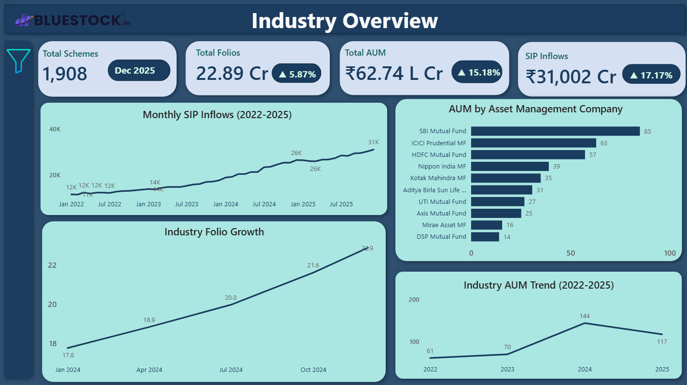
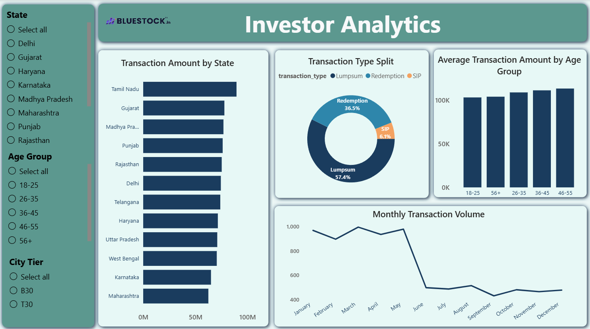
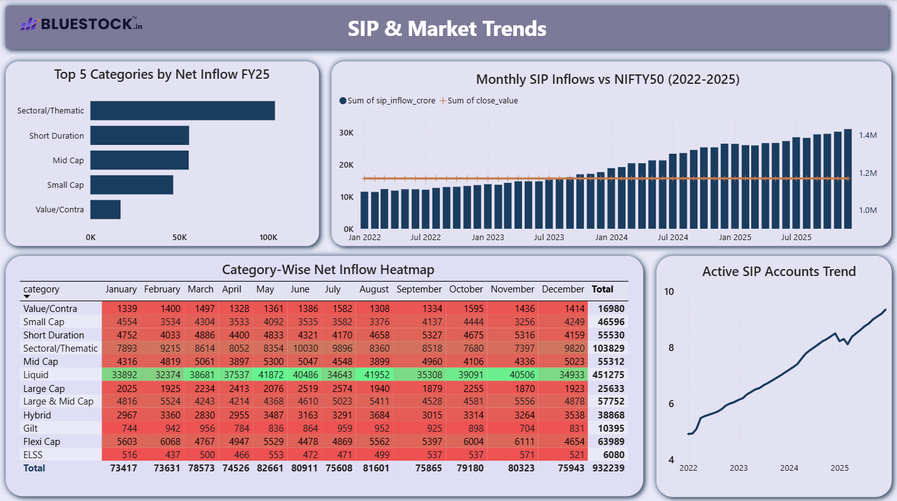

# 📊 bluestock_mf_capstone

## 📖 Overview

The **bluestock_mf_capstone** project is an end-to-end data analytics solution developed during my internship at **Bluestock Fintech**. The project focuses on transforming raw mutual fund datasets into meaningful business insights through data engineering, financial analytics, advanced risk analysis, and interactive business intelligence dashboards.

The solution automates the complete analytics pipeline—from data ingestion and cleaning to performance evaluation and dashboard visualization—enabling data-driven investment decision-making.

---

# Project Objectives

- Build an automated ETL pipeline for mutual fund datasets.
- Clean, validate, and standardize raw financial data.
- Design and implement a relational SQLite database.
- Perform Exploratory Data Analysis (EDA).
- Calculate key mutual fund performance metrics.
- Conduct advanced financial and investor analytics.
- Develop an interactive Power BI dashboard.
- Implement a mutual fund recommendation system based on investor risk appetite.

---

## 🚀 Project Highlights

- ✅ Automated ETL pipeline using Python
- ✅ Cleaned and validated 10+ mutual fund datasets
- ✅ Designed and implemented a SQLite relational database
- ✅ Performed comprehensive Exploratory Data Analysis (EDA)
- ✅ Calculated key financial performance metrics:
  - CAGR
  - Sharpe Ratio
  - Sortino Ratio
  - Alpha & Beta
  - Maximum Drawdown
  - Tracking Error
- ✅ Conducted advanced financial analytics:
  - Historical VaR & CVaR
  - Rolling 90-Day Sharpe Ratio
  - Investor Cohort Analysis
  - SIP Continuity Analysis
  - Sector HHI Concentration Analysis
- ✅ Developed an interactive Power BI Dashboard
- ✅ Built a Mutual Fund Recommendation System based on investor risk appetite

---

# 🛠 Technology Stack

| Category | Technologies |
|----------|--------------|
| Programming Language | Python |
| Data Processing | Pandas, NumPy |
| Visualization | Matplotlib, Seaborn |
| Database | SQLite |
| Query Language | SQL |
| Dashboard | Microsoft Power BI |
| IDE | VS Code, Jupyter Notebook |
| Version Control | Git & GitHub |

---

# 💡 Skills Demonstrated

- Python
- SQL
- SQLite
- Pandas
- NumPy
- Matplotlib
- Seaborn
- Power BI
- Git & GitHub
- Financial Analytics
- Data Engineering

# 🏗 Project Architecture

```
Raw CSV Files
        │
        ▼
 Data Ingestion (Python)
        │
        ▼
 Data Cleaning & Validation
        │
        ▼
 Processed Datasets
        │
        ▼
 SQLite Database
        │
        ▼
 Financial Analytics
        │
        ▼
 Advanced Analytics
        │
        ▼
 Power BI Dashboard
        │
        ▼
 Business Insights
```

---

# 📂 Project Structure

```
bluestock_mf_capstone/

├── dashboard/
│   ├── bluestock_mf_dashboard.pbix
│   └── bluestock_theme.json
|   └── screenshots/
|            ├── industry_overview.png
|            ├── fund_performance.png
|            ├── investor_analytics.png
|            └── sip_market_trends.png
|            └── nav_detail.png
├── data/
│   ├── raw/
│   ├── processed/
│   └── db/
│       └── bluestock_mf.db
│
├── notebooks/
│   ├── EDA_Analysis.ipynb
│   ├── Performance_Analytics.ipynb
│   └── Advanced_Analytics.ipynb
│
├── reports/
│   ├── EDA/
│   ├── performance_metrics/
│   └── advanced_analytics/
│
├── scripts/
│   ├── data_ingestion.py
│   ├── data_cleaning.py
│   ├── etl_pipeline.py
│   ├── live_nav_fetch.py
│   ├── recommender.py
│   └── sqlite_loader.py
│
├── sql/
│   ├── schema.sql
│   └── queries.sql
│
├── docs/
│   └── data_dictionary.md
│
├── README.md
├── requirements.txt
├── PPT
├── Project_Report
└── .gitignore
```
# 📊 Power BI Dashboard

The project includes an interactive Power BI dashboard developed to visualize mutual fund performance, investor behaviour, SIP trends, and advanced financial analytics.

## Dashboard Preview

### 1. Industry Overview



---

### 2. Fund Performance Analysis


---

### 3. Investor Analytics



---

### 4. SIP & Market Trends



---

### 5. Fund NAV Drill-through


---

# Data Sources

The project utilizes:

- Mutual Fund Master Dataset
- Historical NAV Dataset
- AUM Dataset
- SIP Inflow Dataset
- Category Inflow Dataset
- Industry Folio Dataset
- Portfolio Holdings Dataset
- Benchmark Dataset
- Investor Transactions Dataset
- Live NAV Data

---

# 📈 Key Features

## 🔹 Data Engineering

- Automated ETL pipeline
- Data cleaning
- Missing value treatment
- Data validation
- SQLite database implementation

---

## 🔹 Exploratory Data Analysis

- Investor Demographics
- SIP Trend Analysis
- Category Inflow Analysis
- Sector Allocation
- Industry Trends

---

## 🔹 Performance Analytics

- CAGR
- Sharpe Ratio
- Sortino Ratio
- Alpha & Beta
- Maximum Drawdown
- Tracking Error

---

## 🔹 Advanced Analytics

- Historical VaR & CVaR
- Rolling 90-Day Sharpe Ratio
- Investor Cohort Analysis
- SIP Continuity Analysis
- Sector HHI Concentration Analysis
- Fund Recommendation System

---

## 🔹 Interactive Dashboard

The Power BI dashboard provides:

- Industry Overview
- Fund Performance Analysis
- Investor Analytics
- SIP & Market Trends
- Fund NAV Drill-through Analysis

---

# 💡 Key Business Insights

- Equity-oriented mutual funds attracted the highest investor participation.
- SIP investments demonstrated consistent long-term growth.
- Risk-adjusted returns varied significantly across schemes.
- Portfolio diversification reduced sector concentration risk.
- Investor cohort analysis revealed long-term investment behavior.
- The recommendation engine successfully matched mutual funds with investor risk profiles.

---

# ⚙ Installation

Clone the repository:

```bash
git clone https://github.com/Abhilasha-git/bluestock_mf_capstone
```

Navigate to the project folder:

```bash
cd mutual-fund-analysis
```

Install dependencies:

```bash
pip install -r requirements.txt
```

---

# ▶ Running the Project

Run the ETL Pipeline:

```bash
python scripts/etl_pipeline.py
```

Open Jupyter notebooks from the `notebooks` folder for analytics.

Launch the Power BI dashboard:

```
dashboard/bluestock_mf_dashboard.pbix
```

---

```bash
python scripts/etl_pipeline.py
```

Execute analytics notebooks from the `notebooks` directory.

Open the Power BI dashboard:

```
dashboard/Mutual_Fund_Analytics.pbix
```

---

# Deliverables

- Automated ETL Pipeline
- SQLite Database
- Exploratory Data Analysis
- Performance Analytics
- Advanced Risk Analytics
- Power BI Dashboard
- Mutual Fund Recommendation System
- Final Project Report
- Presentation

---

# 🔮 Future Scope

- Live Mutual Fund API Integration
- Automated ETL Scheduling
- Streamlit Web Application
- Portfolio Optimization Models
- Machine Learning-Based Recommendation Engine
- Automated Weekly Performance Reports

---

# Author

**Abhilasha Aavya**

Bluestock Fintech Internship Project

---

# Acknowledgement

This project was developed as part of the internship program at **Bluestock Fintech**. I sincerely thank the organization and my mentors for their guidance, support, and valuable learning opportunities throughout the project.